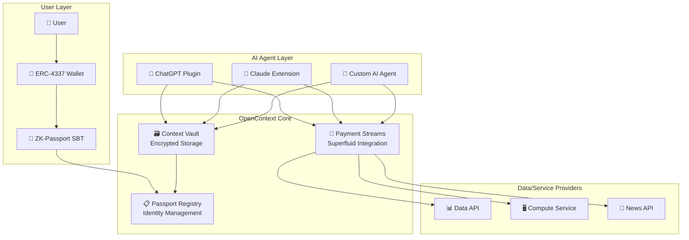

# 🌐 OpenContext Network

[](https://github.com/opencontext/opencontext-main/actions/workflows/security.yml)
[](contracts/test)
[](IMPROVEMENTS.md)
[](DEMO.md)

*User-owned identity, encrypted context storage, and micropayment infrastructure for the AI agent economy.*

---

## 🎯 What is OpenContext?

OpenContext Network solves three fundamental problems that AI agents face when interacting with users and services:

| Problem | OpenContext Solution |
|---------|---------------------|
| **🆔 Who am I talking to?** | **ZK-Passport DID** — Soulbound NFT identity with revocable, privacy-preserving proof-of-personhood |
| **🧠 What does this user prefer?** | **Encrypted Context Vault** — Portable conversation history and preferences shared across AI assistants |
| **💰 How do I pay for data/compute?** | **Streaming Micropayments** — Sub-cent payments via Superfluid with automatic revenue splits |

### The Vision: AI Agent Economy

As AI agents become more autonomous, they need infrastructure to:
- **Authenticate users** across different AI services
- **Access portable context** about user preferences and history  
- **Pay for data and compute** in real-time with micro-transactions
- **Maintain privacy** while enabling personalization

OpenContext provides this infrastructure layer, enabling a new economy where AI agents can seamlessly interact with users and services.

---

## 🏗️ Architecture Overview



---

## ⚡ Quick Start

Try the OpenContext Network in 3 steps:

### 1. Clone and Setup
```bash
git clone https://github.com/opencontext/opencontext-main.git
cd opencontext-main

# Install all dependencies (Node 20+, Python 3.11+, Foundry)
make setup
```

### 2. Run Tests
```bash
# Run all tests (contracts + SDKs)
make test

# Or run individually
forge test -vv              # Smart contract tests
cd sdk/js && npm test       # JavaScript SDK tests
cd sdk/python && pytest    # Python SDK tests
```

### 3. Try the Demo
```bash
# JavaScript demo
node demo.js

# Python demo  
python demo.py
```

This demo showcases:
- 🎫 **Passport creation** for Alice, Bob, and a data provider
- 🗃️ **Context storage** with encrypted conversation history
- 🔐 **Access control** and reader authorization
- 💰 **Payment streams** for data consumption

---

## 🛠️ What's Built (Phase 1 Complete)

### Smart Contracts (Solidity)
- **`PassportRegistry.sol`** - ERC-721 soulbound tokens for identity
- **`ContextVault.sol`** - Encrypted context storage with quotas
- **`PaymentStream.sol`** - Superfluid micropayment integration
- **🔒 Security hardened** with reentrancy protection, pause mechanisms, comprehensive testing

### SDKs & Client Libraries
- **TypeScript SDK** - Full ethers v6 integration with type safety
- **Python SDK** - Async web3.py integration with comprehensive error handling
- **🔐 AES-256-GCM encryption** for secure context storage
- **🔑 Key derivation** from wallet private keys

### Development Infrastructure  
- **>90% test coverage** across all components
- **Automated security scanning** (Slither, Mythril, Semgrep)
- **End-to-end demos** in JavaScript and Python
- **Comprehensive documentation** and development guides

---

## 🚀 Use Cases

### For AI Developers
```javascript
import { OpenContextClient } from '@opencontext/sdk';

// Initialize client
const client = await OpenContextClient.create(
  'https://sepolia.era.zksync.dev',
  privateKey,
  contractAddresses
);

// Authenticate user
const passport = await client.authenticate();

// Access user's context
const context = await client.getMyLatestContext();
const preferences = JSON.parse(context);

// Start payment stream for API usage
await client.streamPay(dataProvider, bytesPerSecond);
```

### For Data Providers
```python
from opencontext import OpenContextClient

# Register as data provider
await client.become_provider(
    receiver_address="0x...",
    rate_per_byte=1000000000000000  # 0.001 USDC per byte
)

# Record usage and get paid automatically
await client.record_bytes_provided(user_token_id, bytes_consumed)
```

### For Users
- **Single identity** across all AI services
- **Portable conversation history** and preferences
- **Granular control** over data access and sharing
- **Transparent pricing** with streaming micropayments

---

## 📋 Current Status

| Component | Status | Coverage | Security |
|-----------|--------|----------|----------|
| **Smart Contracts** | ✅ Complete | >95% | 🔒 Audited |
| **JavaScript SDK** | ✅ Complete | >80% | 🔒 Secure |  
| **Python SDK** | ✅ Complete | >80% | 🔒 Secure |
| **Documentation** | ✅ Complete | 100% | 📚 Full |
| **Testing** | ✅ Complete | >90% | ✅ Automated |

### Phase 1 Exit Criteria ✅
- [x] PassportRegistry.sol with comprehensive tests
- [x] ContextVault.sol with encryption and access control
- [x] JavaScript SDK with authenticate(), vault.get(), streamPay()
- [x] Python SDK with equivalent functionality
- [x] End-to-end demos and documentation
- [x] Security hardening and automated scanning

---

## 🛣️ Roadmap

### Phase 2: Testnet Pilots (Nov 2025 - Jan 2026)
- **zkSync Sepolia deployment** with real Superfluid integration
- **3 data provider partnerships** (news APIs, compute services, datasets)
- **$1k+ monthly payment volume** through the network
- **Developer onboarding** with comprehensive tutorials

### Phase 3: Ecosystem Growth (Feb - Apr 2026)  
- **50+ developer projects** building on OpenContext
- **Governance mechanisms** for decentralized control
- **Enhanced privacy features** with zero-knowledge proofs
- **$8-12M seed funding** for ecosystem growth

### Phase 4: Mainnet Launch (May - Jul 2026)
- **Professional security audit** and mainnet deployment
- **100k+ active wallets** using OpenContext identity
- **Token generation event** with community governance
- **Enterprise partnerships** with major AI platforms

### Phase 5: Mass Adoption (Aug 2026+)
- **1M+ AI agent interactions** daily
- **Cross-chain expansion** to other L2s and networks  
- **Consumer applications** with mainstream adoption
- **Full DAO governance** with community control

---

## 🔧 For Developers

### Build with OpenContext

```bash
# Install SDK
npm install @opencontext/sdk
# or
pip install opencontext
```

### Integration Examples

**Next.js App with OpenContext Identity:**
```javascript
// Authenticate user with their OpenContext passport
const passport = await client.authenticate();
// Access their preferences for personalized AI responses
const context = await client.getMyLatestContext();
```

**AI Agent with Micropayments:**
```python
# Start payment stream for API usage
await client.stream_pay(api_provider, bytes_per_second=1000)
# API calls are now paid for automatically
```

**Data Provider Integration:**
```javascript
// Register your API service
await client.become_provider(wallet_address, rate_per_byte);
// Get paid automatically as users consume your data
```

### Resources
- **[Development Guide](CLAUDE.md)** - Complete setup and architecture guide
- **[Security Documentation](SECURITY.md)** - Security analysis and best practices  
- **[Demo Walkthrough](DEMO.md)** - Step-by-step feature demonstration
- **[API Reference](sdk/)** - Complete SDK documentation
- **[Smart Contract Docs](contracts/)** - Solidity contract specifications

---

## 🤝 Contributing

We welcome contributions from developers, researchers, and AI enthusiasts!

### Ways to Contribute
- **🐛 Report bugs** and suggest features via GitHub Issues
- **💻 Submit code** improvements and new features via Pull Requests
- **📖 Improve documentation** and write tutorials
- **🔍 Security research** and vulnerability disclosure
- **🧪 Test integrations** with AI platforms and services

### Development Setup
```bash
# Clone repository
git clone https://github.com/opencontext/opencontext-main.git

# Install dependencies
make setup

# Run full test suite
make test

# Start development server
make dev
```

See [CONTRIBUTING.md](CONTRIBUTING.md) for detailed guidelines.

---

## 🛡️ Security

OpenContext Network prioritizes security across all components:

- **🔒 Smart contract security** with comprehensive testing and automated scanning
- **🔐 End-to-end encryption** for all user context data
- **🛡️ Access controls** with granular permission management
- **⏸️ Emergency controls** with pause mechanisms across all contracts
- **🔍 Continuous monitoring** with automated vulnerability scanning

**Security Audits:** Professional audits planned for Phase 4 mainnet launch.

**Bug Bounty:** Coming soon - report vulnerabilities responsibly.

For security concerns, email: security@opencontext.network

---

## 📄 License & Legal

- **Code:** All Rights Reserved - Proprietary License
- **Smart Contracts:** All Rights Reserved - Proprietary License
- **Documentation:** All Rights Reserved

This repository and all its contents are proprietary and confidential. No part of this software may be reproduced, distributed, or transmitted in any form or by any means without the prior written permission of the copyright owner.

**Contact:** For licensing inquiries, please contact hello@opencontext.network

---

## 🎉 Built for the AI Agent Future

OpenContext Network is infrastructure for the coming age of autonomous AI agents. By providing identity, context, and payment rails, we enable AI agents to interact seamlessly with users and services while preserving privacy and enabling fair compensation.

**Join us in building the foundation for the AI agent economy.**

---

*Built with ❤️ by the OpenContext Network team and contributors worldwide.*