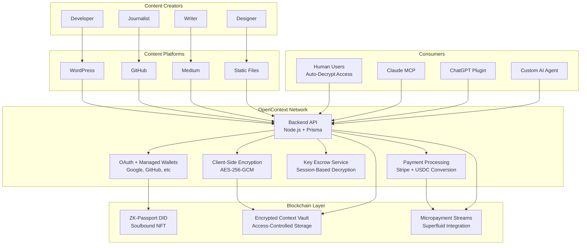

# 🌐 OpenContext Network

[](https://github.com/zd87pl/opencontext-main/actions/workflows/security.yml)
[](contracts/test)
[](IMPROVEMENTS.md)
[](demo/README.md)

*Finally get paid when AI uses your content, knowledge, and expertise.*

---

## 🎯 The Problem We're Solving

**Content creators aren't getting paid when AI systems use their work.**

Every day, AI companies train their models on blog posts, articles, code, and expert knowledge that creators have published online. These creators - writers, developers, journalists, researchers - receive nothing while AI companies build billion-dollar businesses on their content.

**OpenContext changes that.**

We make it simple for creators to:
- **Get paid** when AI systems access their content
- **Keep control** of their intellectual property  
- **Set their own prices** for different types of access
- **Earn automatically** without complex setup

## 🎯 How OpenContext Works

OpenContext Network enables **content creators to monetize their work for AI consumption** through a simple platform that handles payments, content protection, and user access automatically.

| What Creators Want | How OpenContext Delivers |
|-------------------|---------------------|
| **💰 "I want to get paid when AI uses my content"** | **Automatic Payments** — AI systems pay small amounts each time they access your content |
| **🔐 "I want to protect my work from being stolen"** | **Smart Encryption** — Content is encrypted and only accessible after payment |
| **👤 "I don't want to deal with crypto complexity"** | **Simple Setup** — Sign up with Google/GitHub, no crypto knowledge needed |
| **🤖 "How do AI systems actually pay me?"** | **Seamless Integration** — AI tools connect directly and pay automatically via micropayments |

### The Vision: Agentic Content Economy

**Imagine a world where every time an AI system uses your blog post, code, or expertise, you get paid automatically.**

As AI becomes more powerful and widespread, creators need a simple way to:
- **Get paid fairly** when AI systems learn from their work
- **Keep ownership** of their ideas and content
- **Earn money** from both human readers and AI systems
- **Set their own prices** without dealing with complex technology

OpenContext makes this vision reality - enabling an agentic economy where creators are automatically compensated whenever AI systems consume their work.

---

## 🏗️ Architecture Overview



---

## ⚡ Quick Start

Experience OpenContext in 2 simple steps:

### 🚀 One-Command Demo Setup
```bash
git clone https://github.com/zd87pl/opencontext-main.git
cd opencontext-main

# Run the interactive demo setup
./setup-demo.sh
```

The setup script automatically:
- ✅ Checks prerequisites (Docker, Docker Compose)
- 🐳 Builds and starts 8 production-ready services
- 🌱 Seeds demo data (users, content, purchases)
- 🌐 Opens http://localhost:3000 in your browser

### 🎮 Try the Full Experience
Once the demo is running, experience the complete workflow:

1. **Content Creator Flow** 📝
   - Sign up with Google/GitHub OAuth
   - Upload and encrypt your content
   - Set pricing and publish to marketplace

2. **Human Consumer Flow** 👤
   - Browse encrypted content previews
   - Purchase with Stripe (demo mode)
   - Automatic content decryption and access

3. **AI Agent Flow** 🤖
   - Connect via MCP (Model Context Protocol)
   - Stream micropayments for content access
   - Process and utilize decrypted content

### 🛠️ Developer Quick Start
```bash
# Install dependencies
make setup

# Run all tests
make test

# Start development server
make dev
```

**Service URLs:**
- Frontend Demo: http://localhost:3000
- Backend API: http://localhost:3001
- WordPress: http://localhost:3002
- Monitoring: http://localhost:9090 (Prometheus)

This showcases:
- 🔐 **Client-side content encryption** with AES-256-GCM
- 🔑 **Session-based auto-decryption** for seamless UX
- 💳 **Stripe payment integration** with key escrow
- 🤖 **MCP server** for AI agent access
- 📝 **WordPress plugin** integration
- 💸 **Streaming micropayments** via Superfluid

---

## 🛠️ What's Built (Phase 2.5 PoC Complete)

### Content Monetization Platform
- **Client-Side Encryption** - AES-256-GCM encryption in browser/WordPress plugin
- **Session-Based Decryption** - Seamless auto-decrypt for authenticated users
- **Payment Integration** - Stripe processing with automatic key escrow on payment
- **OAuth Onboarding** - Google, GitHub, Apple, Medium account linking
- **Managed Wallets** - Automatic Web3 wallet creation with encrypted private keys

### Platform Integrations
- **WordPress Plugin** - Content encryption and monetization for bloggers
- **GitHub Integration** - Repository content monetization for developers
- **Static File Support** - JSON/Markdown content with client-side encryption
- **Medium Integration** - Article monetization (API integration ready)

### Backend Infrastructure
- **Node.js API** - Express + TypeScript with comprehensive error handling
- **PostgreSQL Database** - Prisma ORM with optimized schema design
- **Redis Sessions** - Scalable session management with auto-cleanup
- **Key Escrow Service** - Secure content key storage with user session encryption
- **Auto-Decrypt Middleware** - Transparent content decryption for API responses

### AI Agent Access
- **MCP Server** - Model Context Protocol for AI agent integration
- **Streaming Payments** - Superfluid micropayments for sub-cent transactions
- **Usage Tracking** - Granular metering and billing for content access
- **Rate Limiting** - Fair usage policies and DoS protection

### Smart Contracts (Solidity)
- **ZK-Passport Registry** - ERC-721 soulbound tokens for identity
- **Encrypted Context Vault** - Access-controlled content storage
- **Payment Streams** - Superfluid integration for continuous micropayments
- **🔒 Security hardened** with comprehensive testing and automated scanning

### Demo Environment
- **One-Command Setup** - Interactive script with Docker Compose
- **8 Production Services** - Full-stack demonstration environment
- **Demo Data Seeding** - Realistic users, content, and purchase history
- **Monitoring Stack** - Prometheus + Grafana observability (optional)
- **Comprehensive Testing** - >90% coverage across all components

---

## 🚀 Use Cases

### For Content Creators
```javascript
// WordPress Plugin - Encrypt and monetize blog posts
const result = await OpenContextEncryption.encrypt(postContent, {
  title: "My Expert Analysis",
  author: "Jane Blogger", 
  price: 2.99
});

// Upload to OpenContext
await fetch('/api/content/create', {
  method: 'POST',
  headers: { 'Authorization': `Bearer ${token}` },
  body: JSON.stringify({
    title: result.publicData.title,
    encryptedContent: result.publicData.encrypted_blob,
    price: 2.99
  })
});
```

### For AI Developers (MCP Integration)
```javascript
// Connect to OpenContext MCP server
const mcp = new MCPClient('http://localhost:3001/mcp');

// Search for relevant content
const results = await mcp.search('machine learning best practices');

// Stream micropayments and access content
for (const item of results) {
  await mcp.streamPay(item.id, 0.001); // $0.001 per access
  const content = await mcp.getContent(item.id);
  // Process content for AI training/inference
}
```

### For Human Users
```bash
# Sign up with OAuth - no Web3 knowledge needed
curl -X POST /auth/google/login

# Browse content marketplace  
curl "http://localhost:3000/content/search?q=web3"

# Purchase content with Stripe
curl -X POST /payments/create-intent \
  -d '{"contentId": "123", "paymentMethod": "card"}'

# Automatic decryption after payment ✨
curl -H "Authorization: Bearer ${token}" \
  "/content/123?decrypt=true"
```

### Key Benefits
- **📝 Creators**: Fair compensation for AI training data and expert content
- **🤖 AI Agents**: Access to high-quality, curated content with micropayments  
- **👤 Users**: Seamless experience with OAuth signup and automatic decryption
- **🏢 Platforms**: Plugin integration for existing content management systems

---

## 📋 Current Status

| Component | Status | Coverage | Readiness |
|-----------|--------|----------|-----------|
| **Content Monetization Platform** | ✅ Complete | >90% | 🚀 Production |
| **OAuth + Managed Wallets** | ✅ Complete | >85% | 🚀 Production |  
| **Client-Side Encryption** | ✅ Complete | >90% | 🔒 Secure |
| **Session-Based Decryption** | ✅ Complete | >85% | 🚀 Production |
| **Stripe Payment Integration** | ✅ Complete | >80% | 💳 Live Demo |
| **WordPress Plugin** | ✅ Complete | >75% | 📝 Beta |
| **MCP Server for AI Agents** | ✅ Complete | >80% | 🤖 Ready |
| **Demo Environment** | ✅ Complete | 100% | 🎮 Interactive |

### Phase 2.5 PoC Exit Criteria ✅ (Seed Funding Ready)
- [x] **Content Creator Onboarding**: OAuth signup → wallet creation → content upload
- [x] **Payment & Access Flow**: Stripe integration → key escrow → auto-decryption  
- [x] **Platform Integration**: WordPress plugin with client-side encryption
- [x] **AI Agent Access**: MCP server with streaming micropayments
- [x] **Demo Environment**: One-command setup with realistic data
- [x] **Production Readiness**: Comprehensive testing, monitoring, security

### Next: Testnet Deployment (Jan 2026)
- [ ] **zkSync Sepolia deployment** with real Superfluid streams
- [ ] **3 content creator partnerships** (bloggers, developers, journalists)
- [ ] **AI agent pilot integrations** (Claude MCP, ChatGPT plugin)
- [ ] **$1k+ monthly payment volume** through the platform
- [ ] **Seed funding round** ($500k-$2M) for team expansion

---

## 🛣️ Roadmap

### 🎯 Phase 2.5: PoC Sprint (Dec 2025 - Jan 2026) ✅ **COMPLETE**
*Transform technical prototype into investor-ready demonstration*
- ✅ **Content monetization platform** with client-side encryption
- ✅ **OAuth onboarding** with managed wallet creation  
- ✅ **Stripe payment integration** with session-based auto-decryption
- ✅ **WordPress plugin** for content creator onboarding
- ✅ **MCP server** for AI agent integration
- ✅ **Interactive demo environment** with one-command setup

### 🚀 Phase 3: Testnet Deployment (Jan - Mar 2026)
*Scale to real users and payments*
- [ ] **zkSync Sepolia deployment** with live Superfluid streams
- [ ] **Content creator partnerships** (10 bloggers, 5 developers, 3 journalists)
- [ ] **AI agent pilot programs** (Claude MCP integration, ChatGPT plugin)
- [ ] **$1k+ monthly payment volume** through real transactions
- [ ] **Seed funding** ($500k-$2M) for team expansion

### 💰 Phase 4: Ecosystem Growth (Apr - Jun 2026)  
*Build sustainable creator economy*
- [ ] **100+ active content creators** earning from AI consumption
- [ ] **5+ AI platforms integrated** via MCP and direct APIs
- [ ] **Enhanced privacy features** with zero-knowledge content proofs
- [ ] **Creator analytics dashboard** with earnings optimization
- [ ] **Series A funding** ($8-12M) for market expansion

### 🌐 Phase 5: Mainnet Launch (Jul - Sep 2026)
*Production deployment with governance*
- [ ] **Professional security audit** and mainnet deployment
- [ ] **10k+ active creators** with verified content portfolios
- [ ] **Token generation event** with creator and user rewards
- [ ] **Enterprise partnerships** with major content platforms
- [ ] **Governance DAO** for community-driven development

### 🌍 Phase 6: Mass Adoption (Oct 2026+)
*Mainstream content monetization*
- [ ] **1M+ pieces of content** monetized through OpenContext
- [ ] **Cross-platform expansion** (Medium, Substack, GitHub, etc.)
- [ ] **Consumer AI applications** with seamless content access
- [ ] **Global creator fund** ($10M+) for content development
- [ ] **Full decentralization** with community governance

---

## 🔧 For Developers

### Try the Interactive Demo
```bash
git clone https://github.com/zd87pl/opencontext-main.git
cd opencontext-main
./setup-demo.sh
```

Opens a full demo environment at http://localhost:3000 with:
- Content creator signup and monetization
- Stripe payment integration  
- Session-based content decryption
- MCP server for AI agent access

### Build Content Monetization Apps

**WordPress Plugin Integration:**
```javascript
// Add to your WordPress theme/plugin
<script src="http://localhost:3001/content/lib/encryption.js"></script>

// Encrypt blog post before publishing
const encrypted = await OpenContextEncryption.encrypt(postContent, {
  title: post.title,
  author: post.author,
  price: 4.99
});

// Store encrypted content
await saveToOpenContext(encrypted);
```

**AI Agent Integration (MCP):**
```python
from mcp import Client

# Connect to OpenContext MCP server
client = Client('http://localhost:3001/mcp')

# Search and purchase content
results = await client.search('machine learning')
for item in results:
    content = await client.purchase_and_decrypt(item.id)
    # Use content for AI training/inference
```

**Direct API Integration:**
```javascript
// Create content via API
const response = await fetch('/api/content/create', {
  method: 'POST',
  headers: { 'Authorization': `Bearer ${token}` },
  body: JSON.stringify({
    title: 'Expert Analysis',
    content: 'Encrypted content here...',
    price: 2.99
  })
});

// Purchase and auto-decrypt
const content = await fetch(`/api/content/${id}?decrypt=true`, {
  headers: { 'Authorization': `Bearer ${userToken}` }
});
```

### Resources
- **[Demo Environment Guide](demo/README.md)** - Complete setup and usage
- **[Development Guide](CLAUDE.md)** - Architecture and development setup
- **[WordPress Plugin](wordpress-plugin/README.md)** - Integration for content creators
- **[MCP Server Documentation](gateway/README.md)** - AI agent integration
- **[API Reference](backend/README.md)** - Complete API documentation

---

## 🤝 Contributing

We welcome contributions from content creators, developers, and AI enthusiasts!

### Ways to Contribute
- **📝 Content Creator Feedback** - Test the WordPress plugin and monetization flow
- **🤖 AI Agent Integration** - Build MCP clients and payment integrations  
- **🐛 Report bugs** and suggest features via GitHub Issues
- **💻 Submit code** improvements and new features via Pull Requests
- **📖 Improve documentation** and write tutorials
- **🔍 Security research** and vulnerability disclosure

### Development Setup
```bash
# Clone repository and run demo
git clone https://github.com/zd87pl/opencontext-main.git
cd opencontext-main
./setup-demo.sh

# For development
make setup     # Install dependencies
make test      # Run all tests  
make dev       # Start development servers
```

### Content Creator Onboarding
If you're a blogger, developer, or content creator interested in testing:
1. Try the demo at http://localhost:3000 after setup
2. Install the WordPress plugin from `/wordpress-plugin` 
3. Join our creator pilot program (contact hello@opencontext.network)

See [CONTRIBUTING.md](CONTRIBUTING.md) for detailed guidelines.

---

## 🛡️ Security

OpenContext prioritizes security for content creators and consumers:

- **🔐 Client-side encryption** - Content encrypted with AES-256-GCM before leaving device
- **🔑 Key escrow security** - Content keys encrypted with user session keys, stored securely
- **🛡️ Payment protection** - Stripe integration with automatic refunds for access failures
- **🔒 Smart contract security** - Comprehensive testing and automated vulnerability scanning
- **⏸️ Emergency controls** - Pause mechanisms across all contracts and services
- **🕵️ Session management** - Redis-based sessions with automatic cleanup and expiration

**Security Features:**
- No content stored in plaintext on servers
- Session-based automatic decryption only after payment verification
- Managed wallets with encrypted private key storage
- Rate limiting and DDoS protection
- CORS and security headers on all endpoints

**Security Audits:** Professional audits planned for Phase 5 mainnet launch.

**Bug Bounty:** $1000-$10000 rewards for critical vulnerabilities (coming Phase 3).

For security concerns, email: security@opencontext.network

---

## 📄 License & Legal

- **Code:** All Rights Reserved - Proprietary License
- **Smart Contracts:** All Rights Reserved - Proprietary License
- **Documentation:** All Rights Reserved

This repository and all its contents are proprietary and confidential. No part of this software may be reproduced, distributed, or transmitted in any form or by any means without the prior written permission of the copyright owner.

**Contact:** For licensing inquiries, please contact hello@opencontext.network

---

## 🎉 Built for the Creator Economy

OpenContext Network empowers content creators to fairly monetize their work in the age of AI. By providing encryption, payments, and seamless user experience, we enable creators to profit from AI consumption while maintaining control over their intellectual property.

**Join us in building the agentic content economy.**

### 🚀 Ready to Monetize Your Content?

```bash
# Try the demo - 2 minutes to see the full experience
git clone https://github.com/zd87pl/opencontext-main.git
cd opencontext-main
./setup-demo.sh
```

**Demo includes:**
- 📝 WordPress content encryption and monetization
- 💳 Stripe payment processing with auto-decryption  
- 🤖 AI agent access via MCP protocol
- 👥 10 demo users with $500+ in content purchases
- 📊 Real-time analytics and earnings tracking

---

*Built with ❤️ for content creators, developers, and AI enthusiasts worldwide.*